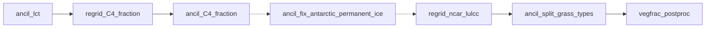

# vegfrac_postproc

`vegfrac_postproc` is not an app itself, but a checkpoint task marking the end of the land cover fraction (vegfrac) post-processing chain. It runs after `ancil_lct` and after whichever optional steps were selected with the `LAND_COVER_PREPROCESSING` option in `rose-suite.conf`. Everything which needs the finished land cover fractions depends on `vegfrac_postproc` rather than on the individual steps.

## Possible tasks

Each step is only run if its key is selected in `LAND_COVER_PREPROCESSING`; any combination (including none) may be selected. Selected steps always run in the order below, regardless of the order they were selected in.

| Order | `LAND_COVER_PREPROCESSING` key | Tasks | Purpose |
|-------|--------------------------------|-------|---------|
| 1 | `c4-fraction` | [regrid_C4_fraction](regrid_C4_fraction.md) => [ancil_C4_fraction](ancil_C4_fraction.md) | Split the combined C3/C4 grass fraction using a Vegetation Percentage dataset |
| 2 | `fix-antarctic-permanent-ice` | [ancil_fix_antarctic_permanent_ice](ancil_fix_antarctic_permanent_ice.md) | Set all land points south of 60°S to 100% ice |
| 3 | `split-grass-types` | [regrid_ncar_lulcc](regrid_ncar_lulcc.md) => [ancil_split_grass_types](ancil_split_grass_types.md) | Redistribute short vegetation into finer grass and shrub types using the NCAR land cover dataset |

The graph shows every step; steps which are not selected are skipped and the chain connects the neighbouring selected steps (dotted links). With no steps selected, `ancil_lct` leads directly to `vegfrac_postproc`.

## How the steps combine

[ancil_lct](ancil_lct.md) and every post-processing app read and overwrite the same `vegetation/qrparm.veg.frac` ancillary in place, so any subset of steps can be chained without the workflow needing to know about file names. Each app also writes a snapshot of its output to `preproc/qrparm.veg.frac_<app name>.nc` for traceability.

## Downstream tasks

These tasks wait for `vegfrac_postproc`: [ancil_LAI](ancil_LAI.md), [ancil_soil_hydrology](ancil_soil_hydrology.md), [ancil_topographic_index](ancil_topographic_index.md), [ancil_soil_albedo](ancil_soil_albedo.md) and [ancil_soil_dust](ancil_soil_dust.md).
